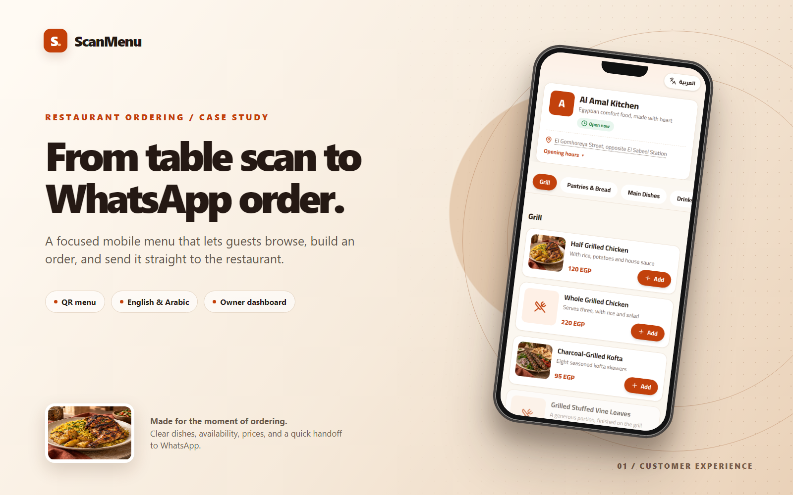
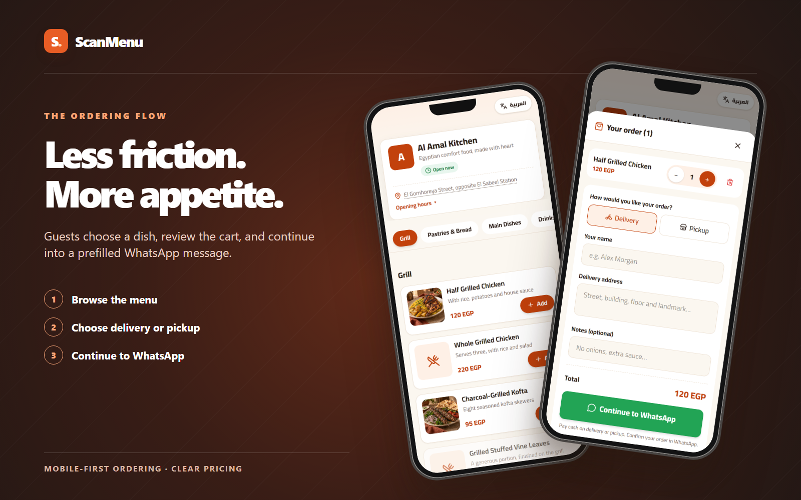
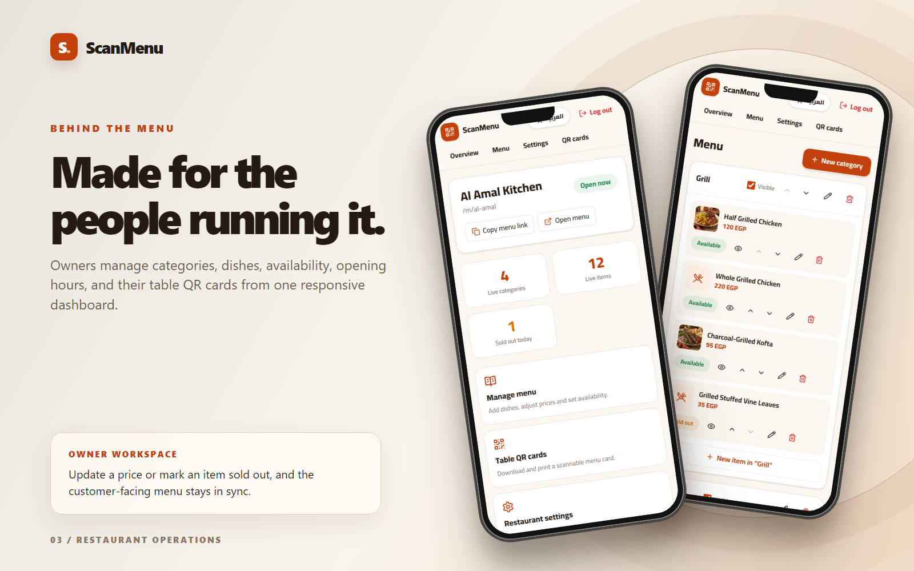

# ScanMenu

A bilingual restaurant menu and WhatsApp ordering experience. Guests scan a table QR code, explore dishes, build a cart, and continue with a prefilled order in WhatsApp. Restaurant owners can update the menu, opening hours, availability, images, and printable QR cards from their dashboard.



## Explore the product

| Ordering flow | Owner workspace |
| --- | --- |
|  |  |

The portfolio images frame screenshots captured from the running English demo. The sample restaurant, food imagery, and prices are showcase content.

## Highlights

- English by default, with a persistent Arabic switcher and right-to-left layout.
- Customer menu with categories, opening status, sold-out items, cart, delivery or pickup details, and WhatsApp handoff.
- Owner workspace for bilingual restaurant and menu content, item photos, availability, opening hours, and QR cards.
- Admin area for restaurant accounts and activation.
- Supabase Auth, Postgres, Storage, and row-level security for connected environments; an in-memory sample restaurant for quick local exploration.

## Run locally

Requires Node.js and [pnpm](https://pnpm.io/). For the sample restaurant:

```powershell
pnpm install
$env:NEXT_PUBLIC_DEMO_MODE = "true"
pnpm dev
```

Open [the customer menu](http://localhost:3000/m/al-amal), [the owner sign-in](http://localhost:3000/login), or [the homepage](http://localhost:3000). The sample data refreshes when the server restarts.

| Area | Email | Password |
| --- | --- | --- |
| Restaurant owner | `owner@demo.menu` | `demo1234` |
| Platform admin | `admin@demo.menu` | `demo1234` |

Run `pnpm lint` and `pnpm build` for project checks. Portfolio captures can be refreshed with `node scripts/capture-portfolio.mjs` while the demo is running.

## Connect Supabase

1. Create a Supabase project and apply the SQL files in `supabase/migrations/` in order.
2. Create the platform admin with [the admin setup guide](docs/ADMIN_SETUP.md).
3. Copy `.env.example` to `.env.local` and set `NEXT_PUBLIC_SUPABASE_URL`, `NEXT_PUBLIC_SUPABASE_ANON_KEY`, and the server-only `SUPABASE_SERVICE_ROLE_KEY`.
4. Set `NEXT_PUBLIC_SITE_URL` to the final HTTPS site URL used on printed QR cards. Leave `NEXT_PUBLIC_DEMO_MODE` unset for the connected app.

## Deploy to Vercel

Import this repository as a Next.js project in Vercel. Add the same environment variables in the project settings, deploy, and add the final site URL to Supabase **Authentication → URL Configuration**. Open a customer menu and complete an order handoff, then sign in as an owner to check menu edits, images, and QR downloads on the deployed domain.

## Stack

Next.js 16 App Router · React 19 · TypeScript · Tailwind CSS 4 · Supabase · Server Actions · pnpm
